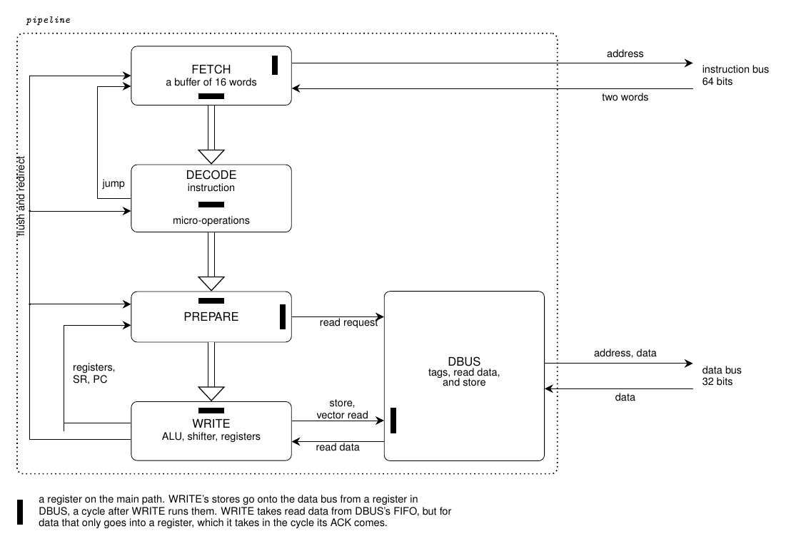
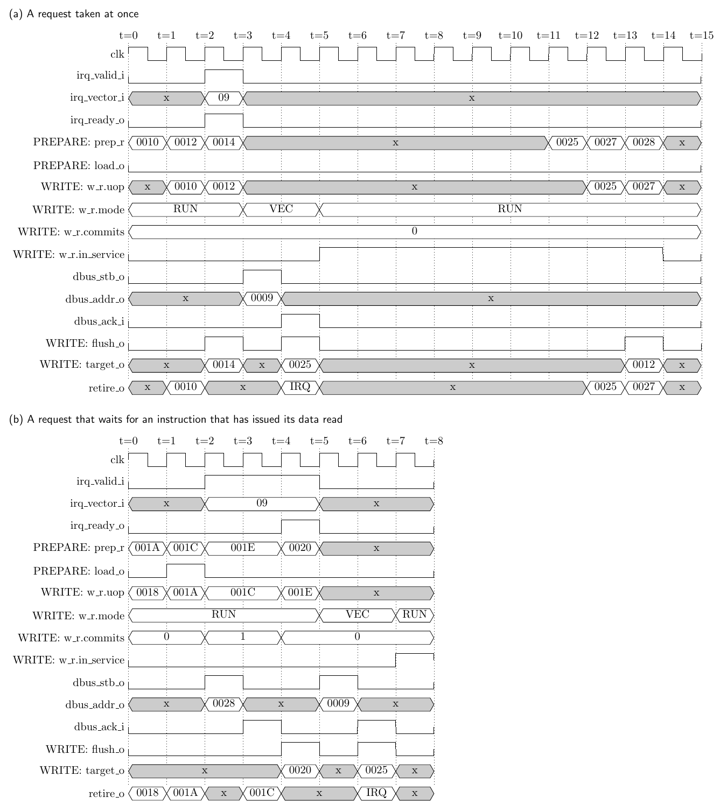

# NICE core microarchitecture

This is the design note for the FPGA implementation of NICE.
[ISA.md](ISA.md) is the specification, and it wins wherever this note
disagrees with it. "ISA §8.2" refers to a section of ISA.md, "SYSTEM §2" to a section of
[SYSTEM.md](SYSTEM.md), and a plain "§5.3" to a section of this note.

The core is pipelined and has separate instruction and data buses, like
[qnice_cpu](https://github.com/MJoergen/qnice_cpu). It reuses that design
where NICE allows it. This note concentrates on where NICE differs.

The pipelined core is `hdl/src/pipeline.vhd`, which connects one entity
for each part: `pipe_fetch` (FETCH), `pipe_decode` (DECODE),
`pipe_prepare` (PREPARE), `pipe_write` (WRITE), and `pipe_dbus` (DBUS,
the data bus port). A simple multi-cycle core,
`hdl/src/multicycle.vhd`, came first. It runs one instruction at a time,
with the same buses, interrupt ports, and trace report, and is the working
reference. Both pass every step of the test order in §9
([hdl/README.md](../hdl/README.md)). Where the pipelined core settled a
question that this note left open, `hdl/ASSUMPTIONS.md` says how.

## Contents

- [1. Decisions at a glance](#1-decisions-at-a-glance)
- [2. What the ISA allows](#2-what-the-isa-allows)
- [3. Pipeline](#3-pipeline)
- [4. Micro-operations](#4-micro-operations)
- [5. Hazards](#5-hazards)
  - [5.1 Registers](#51-registers)
  - [5.2 The condition](#52-the-condition)
  - [5.3 Data accesses](#53-data-accesses)
  - [5.4 Control flow](#54-control-flow)
  - [5.5 Self-modifying code](#55-self-modifying-code)
  - [5.6 How often the hazards occur](#56-how-often-the-hazards-occur)
- [6. Interrupts](#6-interrupts)
- [7. Datapath details](#7-datapath-details)
  - [7.1 Register values](#71-register-values)
  - [7.2 ALU](#72-alu)
  - [7.3 Shifter](#73-shifter)
  - [7.4 Operands, and the value written last](#74-operands-and-the-value-written-last)
- [8. Memory system](#8-memory-system)
  - [8.1 Fetch statistics](#81-fetch-statistics)
- [9. Verification](#9-verification)
- [10. Repository and boards](#10-repository-and-boards)

## 1. Decisions at a glance

| Topic | Decision |
|---|---|
| Structure | A pipeline: FETCH, DECODE, PREPARE, and WRITE, with the data bus port DBUS beside it. As in qnice_cpu, but with its ICACHE in FETCH and its SEQUENCER in DECODE. |
| Buses | Harvard: a read-only Wishbone instruction port, 64 bits wide so that it delivers two words per cycle (§3), and a 32-bit Wishbone data port. Both see the same memory, through dual-port RAM. |
| Instructions | DECODE splits each instruction into one to three micro-operations. |
| Registers | R0–R15 in flip-flops in WRITE, not in a module of their own as in qnice_cpu. Only WRITE writes them, in order. PREPARE reads them and forms every operand value and address; WRITE has one bypass, the value it wrote last (§5.1, §7.4). R0 is always 0. R14 is SR and R15 is PC. |
| Data accesses | Exact, in order, and never speculative, as ISA §8.2 requires. |
| Instruction fetches | Free to run ahead, as ISA §8.2 allows (§2). |
| Interrupts | Taken in WRITE, before an instruction, as soon as ISA §7.1 allows (§6). Valid/ready request ports for NMI and IRQ. |
| Language | VHDL-2008, GHDL for simulation, and SymbiYosys for formal verification. Synthesis for a board is done in the example design (§10). |
| Verification | A trace writer diffed against `niceemu --trace`, then formal checks with SymbiYosys. |
| Location | The `hdl/` directory, with commit prefix `nicehdl:` (§10). |
| Boards | None in this repository. The design is board-agnostic, and generics set the memory map (§10). |

## 2. What the ISA allows

A pipeline must fetch ahead, and a Harvard core cannot keep its two buses in
one order. So ISA.md distinguishes instruction fetches from data accesses:

- **ISA §8.2** splits accesses into instruction fetches and data accesses. Only
  data accesses (operand reads, destination writes, and vector reads) must be
  exact and in order. Instruction fetches may run early, repeat, or be wasted.
  Each instruction still runs with the words memory held once the
  instructions before it had completed, so self-modifying code works as
  before (§5.5).
- **ISA §8.3** says that instruction fetches never reach I/O devices. A fetch
  from `0xFFFFFF00`–`0xFFFFFFFF` reads 0. Without this, a fetch running ahead
  could start a device access. The emulator follows it, and
  `emulator/test/iofetch.nasm` tests it.
- **ISA §7.1** checks for interrupts "before each instruction", not "before
  each instruction fetch".
- **Appendix B** records both rules.

Nothing else in the ISA constrains the pipeline. Conditional execution, the side
effects, R15 as an operand, and interrupts are all handled in the pipeline.

## 3. Pipeline

[pipeline.png](pipeline.png) is drawn by [pipeline.tex](pipeline.tex), and
`make diagrams` in the top directory renders it. Edit the LaTeX, not the
PNG. The same in text:

    pipeline
    +-----------------------------------------------------------+
    |  +---------->   FETCH   <-----------------------------------> instruction bus
    |  |  +------->     |                                       |   (64 bits)
    |  |  |             |                                       |
    |  |  +- jump --  DECODE                                    |
    |  |                |                                       |
    |  |  +------->   PREPARE   -- read -->  +-----------+     |
    |  |  |             |                    |   DBUS    |<-------> data bus
    |  |  | registers   |                    | tags and  |     |   (32 bits)
    |  |  +---------   WRITE   -- store -->  | read data |     |
    |  |                |      <-- data ---  +-----------+     |
    |  +- flush and ----+                                       |
    |     redirect                                              |
    +-----------------------------------------------------------+

Each part is the VHDL entity of its name in `hdl/src/`: FETCH is
`pipe_fetch`, DECODE is `pipe_decode`, and so on. `pipeline` connects
them. The black bars of the PNG mark the registers on the main path,
which the header of `pipeline.tex` names.

The parts do what they do in qnice_cpu, with these differences:

- **FETCH** reads two words per cycle: the instruction port is 64 bits wide
  and reads an aligned pair of words. Its address a names words 2a and
  2a + 1, and it returns word 2a in bits 31..0 and word 2a + 1 in bits
  63..32, low word first as in ABI.md. The multi-cycle core has the same
  port. An instruction is 2.1 words on average
  in translated code and 1.6 in hand-written code (§5.6), so a port that
  delivers one word per cycle would hold the core to about one instruction
  per two cycles, whatever the rest of the pipeline did. FETCH keeps the
  words in a buffer, and presents up to four of them to DECODE: the
  instruction word and up to three constant words.
- **DECODE** takes the instruction only when all its words are present.
  The length follows from the instruction word (ISA §2.3). It knows PC,
  which is the instruction's address plus its length, and it reads no
  register (§5.1). It decodes the fields that the later stages need once,
  so that their logic starts from registers (§7.4). It emits the
  micro-operations of §4, one per cycle. It holds a second instruction
  behind the one it splits, so that it takes instructions from FETCH
  without waiting on the stages below it, which keeps WRITE's decisions
  off the path into FETCH.
- **PREPARE** reads the registers, forms operand values and addresses
  (§7.4), reduces the shift count (§7.3), and issues data reads.
- **WRITE** holds the ALU and the shifter, writes registers and memory,
  updates SR, checks the condition, and starts flushes and interrupts.
- **DBUS** is the data bus port. It keeps a tag for each request in
  flight, and the read data that WRITE has not used yet.

Each stage holds one item and passes it on when the next stage is free,
or frees itself in the same cycle. qnice_cpu builds its stages from the
valid/ready primitives of its `src/sub/`. The NICE core writes the
handshake of each stage by hand, because PREPARE's decisions depend on
the state of WRITE in the same cycle (§5.3).

## 4. Micro-operations

A micro-operation makes at most one register write, so the registers need
one write port. DECODE emits:

| Micro-op | When | What it does |
|---|---|---|
| `S0` | s0 has a side effect on a register other than R0 (modes 001, 010, 101, and 110) | Reads s0 if it is in memory. Writes Rx ± 1. |
| `S1` | the same for s1 | Reads s0 first, if it is a memory operand not yet read. Then reads s1 if it is in memory, and writes Ry ± 1. |
| `OP` | always, for ALU and SHIFT instructions | Reads the memory sources not yet read. Computes r. Writes the destination and applies its side effect. Updates the flags. |
| `CTRL` | control instructions | `HALT`, `RTI`, `INT`, or a reserved word. |

Reads happen in field order, s0 then s1, as ISA §8.2 requires. That is why `S1`
also reads an s0 that has no micro-op of its own.

The common instructions need one micro-op: `ADD R1, R2, R3`, `MOVE R1, 5`,
the push `MOVE @--SP, x`, and the call `ADD @--SP, 2, PC`. A pop
`MOVE x, @SP++` and a return `MOVE PC, @SP++` need two. The most any
instruction needs is three. In the benchmark programs an instruction has
1.02 micro-ops on average when translated and 1.18 when written by hand
(§5.6), so splitting them seldom adds a cycle.

**One write per micro-op is enough** because the two writes of a register
destination in mode 001 or 010 are one value, Rx ← regval(x, regval(x, r) ∓ 1)
(§7.1), which WRITE writes in two cycles: r, then the adjusted value
(§7.4). Neither benchmark has such a destination (§5.6). In a memory
destination mode, the side effect is the only register write.

**s1 can depend on s0's side effect**, as in `ADD R1, R2++, @R2`. `S0` writes
R2 in WRITE, before s1's address is formed. PREPARE waits for that write
(§5.1).

## 5. Hazards

### 5.1 Registers

Only WRITE writes registers, and it runs the micro-ops in program order.
So when a micro-op reaches WRITE, every older one has retired, and the
registers hold the values it needs. PREPARE reads them one cycle
earlier, for every operand, and forms the values and addresses (§7.4).
Then only the micro-op in WRITE at that moment can still change a
register PREPARE read, and it writes one register at most. WRITE keeps
a copy of the value it wrote last, and a field whose value is that
register takes the copy instead. That one bypass matters, because about
three in ten instructions read a register the previous instruction
writes (§5.6): they run back to back.

A field whose value needs an adder on the register, `R + c` or `R − 1`,
and a register that a data read's address needs, cannot take the copy,
because the adder would then follow the ALU of the micro-op before. So
PREPARE waits while the micro-op in WRITE will still write that
register, and reads it in the cycle after. That costs a cycle for a
pointer that the previous micro-op writes, as in `ADD R1, R2++, @R2` or
a load through a register just loaded, and for a sum on a register just
written, which is rare (§5.6). It saves the bypass network, and the
three read ports in DECODE that would feed it.

R14 is SR, which WRITE keeps. R15 is the instruction's next address,
carried with it, unless an earlier micro-op of the same instruction wrote
R15 (§5.4).

### 5.2 The condition

Every instruction is conditional, and the condition reads SR as it was before
the instruction started (ISA §3). Many instructions write SR, so this is the main
hazard.

- **A micro-op with no data access** checks the condition in WRITE, where SR
  is current. It needs no stall. If the condition is false, WRITE discards
  it. This covers the common pair `SUB[M] R0, a, b` followed by
  `?Z MOVE PC, label`.
- **A micro-op with a data read** must know its condition before PREPARE
  issues the read (§5.3). It waits in PREPARE while any older micro-op in
  flight can still change SR. A store is issued in WRITE, where the condition
  is known, so it needs no wait.
- **An instruction with condition "always"** never waits for SR.

The condition is decided once per instruction. A skipped instruction's
remaining micro-ops go through as bubbles, so none of its side effects
happen (ISA §3).

### 5.3 Data accesses

ISA §8.2 keeps data accesses exact, in order, and never speculative. So PREPARE
issues a data read only when the instruction is certain to run:

1. Its condition is known (§5.2).
2. No older micro-op in flight can still redirect: a write to R15, `RTI`,
   `INT`, a halt, or a store that may hit fetched code (§5.5).
3. Every older store has been issued, so the read cannot overtake it.
4. No interrupt request is pending that could be taken before it (§6): an
   NMI that is valid while `in_service` = 0, or an IRQ that is valid while
   `in_service` = 0 and either E = 1 or an older micro-op in flight may
   still set E. An IRQ with E = 0 does not count, or a program that never
   sets E could never read memory. The instruction directly after an `RTI`
   is exempt, because ISA §7.1 holds every request off until it has retired.
   The instruction after that is not. An instruction that has issued a
   data read already, or whose first micro-op has retired, is exempt too,
   because no request can be taken before it any more. Without that, a
   request that came between the two reads of `ADD R1, @R2, @R3` would
   hold the second read off for ever.

When PREPARE issues an instruction's first data read, the core commits to
that instruction. No interrupt is taken before it (§6).

Stores are issued in WRITE, which is in order, so they need no extra rule.

A data read directly after a store is 0.3% of the translated benchmark's
instructions and 8% of the hand-written one's (§5.6). So rule 3 matters:
the read must be allowed in the cycle after the bus accepts the store, not
after the store's instruction retires.

Rules 1 and 2 cost a cycle or two for a conditional read after a write of
SR, and for a read after a conditional jump. These are 0 to 4% and 5 to 8%
of the instructions (§5.6), so data reads stay exact for now. If the cost
turns out to matter, the ISA could later let reads of RAM (not of the I/O
range) be speculative. That needs a check of each read against older
stores, so the core does not do it.

### 5.4 Control flow

WRITE flushes the stages above it and redirects FETCH when:

- A micro-op writes R15. This is every jump that DECODE did not resolve.
  The target of `MOVE R15, x` is the source itself, a constant, a
  register, or a word read from memory, which WRITE has at the start of
  its cycle, so the redirect does not wait for the ALU. Any other
  operation on R15, such as `ADD R15, R15, R1`, writes R15 in one cycle
  and redirects in the next (§7.4). Neither benchmark has one (§5.6).
- An `INT`, an `RTI`, or an interrupt (§6) is taken.
- A store may hit a word already fetched (§5.5).

DECODE redirects early for jumps it can resolve itself: condition "always",
destination R15 in mode 000, and a source with no memory access, such as
`MOVE PC, label` and `ADD PC, PC, offset`. qnice_cpu does the same.

A side effect on R15 in `S0` or `S1`, such as `MOVE R1, @R15++`, must not
flush the instruction's own later micro-ops. As in qnice_cpu, the flush waits
for the instruction's last micro-op. A later operand of the same instruction
that reads R15 sees the side effect (ISA §4.3), so it takes R15 from the PC
register after that micro-op has retired, not from DECODE. R15 as a pointer
is rare, so a slow path is fine.

R14 as an operand is not rare. The signed comparison of ISA §9.2,
`?V XOR R14, R14, 0x10000000`, reads and writes it directly, and it is 7%
of the hand-written benchmark's instructions (§5.6). So WRITE reads R14 from
the SR it keeps, like any other register, with no wait. R15 as a pointer or with
a side effect occurs in neither benchmark, so its slow path stays slow.

### 5.5 Self-modifying code

A store can change a word that FETCH has already read. WRITE compares each
store address with the words that are fetched but not yet retired. While
FETCH runs straight on, they are one range, from the storing instruction's
next PC to FETCH's current address. After an early redirect by DECODE (§5.4)
they are two: the words from the storing instruction up to the jump, and the
words from the jump's target to FETCH's current address. So WRITE checks the
range held in FETCH, from the oldest word in its buffer to its current
address, and the one to four words of each instruction in DECODE and
PREPARE. On a hit, it flushes and refetches from the
next instruction. Over-approximating is safe, because a needless flush costs
only cycles. qnice_cpu uses a fixed window of 32 words for the same purpose.

The compares are cheap on purpose, because the flush they raise must
reach PREPARE and FETCH in the same cycle. FETCH's range is at most 16
words, and an instruction at most 4. So WRITE tests whether the store
lies in the aligned block of 32 words that holds FETCH's oldest word, or
in the block after it, and in the aligned block of 4 words that holds
each instruction, or the block after it: equality compares on the high
address bits, with no subtraction. The numbers of the blocks after are
computed ahead, in registers: an instruction's when DECODE takes it,
and FETCH's from its oldest word's address a cycle late, so that the
redirect target needs no adder. FETCH's oldest word moves by at most
four words a cycle, so WRITE also tests the block after that one, and
in the cycle after a redirect, when the number is stale, no store can
retire. The store address itself comes from PREPARE (§7.4), or is the
value WRITE wrote last.

A store into the storing instruction's own constant words must not change
it, and refetching from the next instruction gives that.

### 5.6 How often the hazards occur

`bench/hazards.py` counts the hazards above in a program, from the
emulator's trace, and `make hazards` in `bench/` runs it on the two
benchmark programs ([bench/README.md](../bench/README.md)). A skipped
instruction counts as if it ran, because DECODE sees its operands before
the condition is known. These are the shares of all instructions:

| | `bench.c` through nicewasm | `hand.nasm` |
|---|---|---|
| Instructions | 1775455 | 494070 |
| Skipped | 19.7% | 18.4% |
| Words per instruction, mean | 1.84 | 1.62 |
| Micro-ops per instruction, mean | 1.00 | 1.18 |
| Conditional | 21.7% | 27.7% |
| Data read | 11.3% | 41.7% |
| Store | 5.1% | 15.4% |
| Jump: writes R15, or a control instruction | 19.5% | 21.1% |
| Reads a register the previous instruction writes | 32.2% | 30.0% |
| Reads a register written two back, not one | 8.0% | 14.0% |
| Conditional, SR written by the previous instruction | 19.5% | 20.3% |
| Conditional with a data read, SR written by the previous | 0.0% | 3.8% |
| Data read after a store | 0.3% | 8.1% |
| Data read after a conditional jump | 5.5% | 7.6% |
| R14 read as an operand | 2.9% | 6.6% |
| R15 as a pointer, or with a side effect | 0% | 0% |

The numbers support three decisions: FETCH reads two words per cycle (§3),
a register written by the previous instruction is read without a wait
(§5.1), and so is R14 (§5.4). They left speculative reads out (§5.3). The reads from the previous
instruction are value chains, mostly in R1 to R4, not stack operations: R13
alone is under 1% in both programs.

## 6. Interrupts

Requests use valid/ready ports, as in qnice_cpu. The device holds `valid` and
the vector until the core raises `ready`. So the device holds the pending
state of ISA §7.1, and requests are never lost.

WRITE takes a request before an instruction, the first one after reset
included, when ISA §7.1 allows it: not halted, `in_service` = 0,
`after_rti` = 0, and E = 1 for IRQ. NMI goes first. Entry (ISA §7.2) flushes
the pipeline, saves PC and SR, reads the vector through the data port, and
redirects FETCH.

A request is taken at the first instruction boundary where ISA §7.1 allows
it, as in the emulator. ISA §7.1 says a request "is taken" when the
conditions hold, and promises that a request deferred during an interrupt
routine is taken before the second instruction after `RTI`. Rule 4 of §5.3
makes this possible: no younger instruction issues a data read while a
request is pending that could be taken before it, so the core never has to
choose between a wasted access and a late interrupt. The one delay is the
instruction after `RTI`, which `after_rti` protects until it has retired.

A request that arrives after a younger instruction has issued its first data
read is taken after that instruction. Software cannot tell this from a
request that arrived one instruction later, and ISA §7.1 leaves the timing of
the request signals to the hardware interface.

`INT` and `RTI` run in WRITE as `CTRL` micro-ops, and flush.

[interrupt.png](interrupt.png), drawn by [interrupt.tex](interrupt.tex),
shows both cases on the core, with values read off a simulation of
`hdl/test/irqwave.nasm`. In (a) the request comes while WRITE holds an
instruction that has not begun. `irq_ready_o` rises at once, the flush
drops that instruction, WRITE reads the vector table entry on the data
bus, and the entry retires and redirects FETCH in the cycle the data
comes. In (b) the request comes in the cycle after PREPARE issued the
data read of `MOVE R2, @data`. That instruction is committed
(`w_r.commits` = 1), so `irq_ready_o` waits until it has retired, and the
request is taken before the next one.

## 7. Datapath details

### 7.1 Register values

R0 is not stored. SR's bit 24 is a constant 1. Every value read from register
*x*, or produced by a side effect on *x*, goes through the function below.
The multi-cycle core applies it on every write instead, which gives the same
values.

    regval(x, v) = 0            if x = 0
                   v OR 2^24    if x = 14
                   v            otherwise

This covers several rules of ISA §4.3 that are easy to miss. `@--R0` addresses
word 0, not `0xFFFFFFFF`. `@--R14` after reset addresses `0x01FFFFFF`. `--R0`
reads 0. Every write to R14 sets bit 24. `MOVE R14--, 0` leaves `0x01FFFFFF`
(ISA §4.2).

### 7.2 ALU

The arithmetic operations share one 32-bit adder `A + B + k`, with A = s0:

| Operation | B | k | C flag |
|---|---|---|---|
| `ADD` | s1 | cin | carry out |
| `DBL` | s0 | cin | carry out |
| `MDBL` | s0 AND s1 | cin | carry out |
| `SUB` | NOT s1 | NOT cin | NOT carry out (the borrow) |
| `DEC` | `0xFFFFFFFF` | 0 | NOT carry out |

`cin` is SR's C bit if the instruction's C bit is set, and 0 otherwise. The
ALU is in WRITE, so `cin` is read after the side effects of `S0` and `S1`, as
ISA §5.1 requires. V is the usual adder rule for all five operations: A and B have
the same sign, and r has the other sign. This matches ISA §5.1 for subtraction,
because B is the inverted subtrahend.

The logic operations, `MOVE`, and `ONE` are a 16-way mux. X, Z, and N come
from r.

### 7.3 Shifter

The count is all 32 bits of s1, with no modulo (ISA §5.2). So the shifter uses the
closed forms of ISA §5.2. It needs three reduced counts:

- **Fixed-fill shifts:** n saturated to 33.
- **32-bit rotations:** n mod 32, which is bits 4..0.
- **33-bit rotations through carry** (`C<C`, `C>C`): n mod 33. Because
  32 ≡ −1 (mod 33), split n into 5-bit digits d0 (bits 4..0) to d6
  (bits 31..30). Then n ≡ d0 − d1 + d2 − d3 + d4 − d5 + d6 (mod 33). The sum
  lies between −93 and 96. Plus 99, it is between 6 and 195, and a table
  of 256 entries finishes it.

The reduction does not depend on s0, so it is done before WRITE, and
the shifter itself is one structure for all sixteen operations: a
vector of 66 bits, built from s0, C, and the fill bit, shifted right by
a count k, of which the low 32 bits are the result and bit 32 is the bit
for C. The multi-cycle core reduces the count in the shift itself; the
pipelined core prepares k, the kind of vector, the fill, and the rule
for C ahead (`shift_prep` and `shift_fast` in `hdl/src/nice_pkg.vhd`,
checked against each other by `hdl/test/tb_shift.vhd`):

| Shift | Vector, bit 65 first | k |
|---|---|---|
| Fixed fill to the left | C, s0, 33 fill bits | 33 − sat |
| Fixed fill to the right | 34 fill bits, s0 | sat; C gets s0(sat − 1) |
| `C<C` | C, s0, C, s0 | 33 − (n mod 33) |
| `C>C` | the same | n mod 33, or 33 for 0 |
| Rotation to the left | 0, 0, s0, s0 | 32 − (n mod 32) |
| Rotation to the right | the same | n mod 32 |

So a right shift is a left shift with another count, and no reverse is
in the shifter's path. Where the count is reduced:

- **In DECODE**, for a constant count, which is most shifts (§5.6).
- **In PREPARE**, for a count in a register, but for `C<C` and `C>C`,
  whose n mod 33 PREPARE cannot afford after the register read.
- **In WRITE, in a cycle of its own**, for a count read from memory, a
  count through an adder (`R − 1` or `c[R]`), a count in a register that
  the micro-op before writes or in R14, a count with a side effect, and
  a rotation through C by a register. The shift then takes two cycles,
  or three for a rotation through C, whose count mod 33 takes a cycle of
  its own. Neither benchmark has one: the translated byte accesses compute
  their shift count in a register ahead of the bounds check
  ([translator/README.md](../translator/README.md)).

### 7.4 Operands, and the value written last

Every value that WRITE computes with starts in a register: the ALU and
the shifter are the only logic in its cycle, besides the one adder that
a side effect `R++` needs. PREPARE reads the registers for the three
fields of the micro-op, and forms for each the value, in a source
field, or the address, in a destination field, with an adder for the
modes that need one: `R + c` for `c[R]` and `@c[R]`, and `R − 1` for
`--R` and `@--R`. The read addresses are the same values. It also
decides where WRITE takes each field from:

- **The value PREPARE formed**, as a rule.
- **The value WRITE wrote last**, if the field is a plain register, in
  mode 000, 010, 100, or 110, that the micro-op in WRITE writes now. WRITE
  keeps that value in a register of its own, so that the field needs no
  mux over the sixteen registers in WRITE's cycle (§5.1). For a read
  address in mode 100 or 110 PREPARE waits instead, since it needs the
  address itself.
- **SR**, if the field is R14 in one of those modes, because the micro-op
  in WRITE may change the flags, which are not a value it wrote.

R15 takes the value WRITE wrote last only from an earlier micro-op of
the same instruction, as in `ADD R4, R15++, R15`. An older instruction
that writes R15 either flushes this one or, if its jump was skipped or
DECODE had resolved it, leaves R15 as this instruction's next address,
which PREPARE knows (§5.4).

A field that needs the adder on a register the micro-op in WRITE writes
waits a cycle, as §5.1 says.

Three rare cases take WRITE two cycles, so that none of them is on the
paths of the common ones: a register destination in mode 001 or 010,
whose adjusted value follows the result (§4); a jump whose target is not
a `MOVE`'s source (§5.4); and a shift whose count PREPARE could not
reduce (§7.3). The first cycle computes and writes the result, and in
the third case reduces the count; the second cycle writes the adjusted
value, redirects FETCH, or shifts. An interrupt is not taken between the
two (§6).

## 8. Memory system

The repository will provide a system around the core: dual-port RAM, the
bus decoders, a default slave, and the console UART. So far only the data
bus decoder exists, and `hdl/sim/wb_mem.vhd` stands in for the rest in
simulation (TODO.md). The system is not tied to a board. Generics set the memory map, for example the size and base address of
each RAM and the address of the UART. These rules hold for every setting:

- **Dual-port RAM.** The instruction port and the data port reach the same
  RAM, through a 64-bit port and a 32-bit port. Any memory that the data
  port sees must be visible to the instruction port too, except the I/O
  range.
- **Unmapped addresses.** Both buses need a default slave that acknowledges a
  read with 0 and drops a write (ISA §8.2). Without one, the core would wait
  forever.
- **Bus decoder.** The data bus decoder keeps the ACKs in order when
  requests to different slaves are in flight, since the math unit holds an
  ACK for up to 65 cycles: a request to one slave waits while a request to
  another is still owed its ACK. `hdl/src/wb_dmux.vhd` does this, and the
  testbench `tb_core` uses it. So a data read may wait on the bus.
- **I/O.** Only the data bus reaches I/O. The instruction bus returns 0 for
  the I/O range (ISA §8.3).
- **Console.** A UART at `0xFFFFFF00` by default, as in the emulator
  (SYSTEM §1). A write sends bits 7..0. A read returns the next received
  byte with bit 8 set, or 0 if none has arrived. Not written yet; the
  memory model's console reads a file instead
  ([hdl/README.md](../hdl/README.md), The memory model).
- **Math unit.** `hdl/src/mpu.vhd` at `0xFFFFFF20`–`0xFFFFFF3F` (SYSTEM §2), 32
  aligned words, so the decoder compares address bits 31..5.
  A read of a result holds off its ACK until the result is ready, so the
  data bus must allow a slave to take many cycles.
- **Performance counters.** `hdl/src/perf.vhd` at `0xFFFFFF40`–`0xFFFFFF4F`
  (SYSTEM §3). The core raises `instret_o` for one cycle per completed
  instruction. A read of `INSTR_LO` must count every older instruction,
  and not its own. So the pipelined core counts an instruction with a data
  read in the cycle the bus accepts its last read, and one without in the
  cycle it retires. The counters return a count from before that cycle's,
  and PREPARE issues a younger read only then. `hdl/test/instret.nasm`
  checks this, also behind a read that waits on the bus.
- **Timer.** `hdl/src/timer.vhd` at `0xFFFFFF10`–`0xFFFFFF1F` (SYSTEM §4),
  with its request on the core's IRQ port. It is the only device that
  raises IRQ so far, so it needs no interrupt controller.
- **Fetch statistics.** `hdl/src/fetch_stats.vhd` at
  `0xFFFFFF50`–`0xFFFFFF7F` (§8.1), 48 words, so the decoder compares
  address bits 31..6 and leaves out `0xFFFFFF40`–`0xFFFFFF4F`. The
  pipelined core reports what FETCH and DECODE do in each cycle on its
  port `stats_o`, and the device counts it: the words in FETCH's buffer,
  the cycles DECODE waits for words, the cycles FETCH has no room for a
  request, and more. They show how much of the buffer is used, and so
  whether its 16 words are too many or too few.
- **Stack.** The runtime puts the stack just below `0xFFFFFF00`. A memory map
  that runs the runtime's programs needs RAM there as well as at address 0.

### 8.1 Fetch statistics

`hdl/src/fetch_stats.vhd` counts what FETCH and DECODE of the pipelined
core (§3) do, in 48 words of I/O at `0xFFFFFF50`–`0xFFFFFF7F`. They help to
judge the size of FETCH's buffer. They are a property of this core, not of
the ISA, so ISA.md does not describe them. The emulator has none, and the
range is ordinary memory there. The generic `G_ENABLE` leaves them out of
the core; every word then reads 0.

| Address | Name | A data read returns | A write |
|---|---|---|---|
| `0xFFFFFF50` | `FS_CTRL` | the run bit R in bit 0, and 0 in bits 31..1 | sets R to bit 0; if bit 1 is set, also clears the counters |
| `0xFFFFFF51` | `FS_CYCLES` | the cycles counted | is ignored |
| `0xFFFFFF52` | `FS_STARVE` | the cycles in which DECODE could take an instruction, but FETCH did not have all its words | is ignored |
| `0xFFFFFF53` | `FS_BLOCKED` | the cycles in which FETCH had all the words of the next instruction, but DECODE was busy | is ignored |
| `0xFFFFFF54` | `FS_FULL` | the cycles in which FETCH could have sent a request, but its buffer had no room | is ignored |
| `0xFFFFFF55` | `FS_STALL` | the cycles in which the instruction bus stalled a request | is ignored |
| `0xFFFFFF56` | `FS_PAIRS` | the pairs of words that arrived on the instruction bus, wasted ones included | is ignored |
| `0xFFFFFF57` | `FS_WORDS` | the words that DECODE took | is ignored |
| `0xFFFFFF58` | `FS_JUMPS` | the jumps that DECODE resolved | is ignored |
| `0xFFFFFF59` | `FS_FLUSHES` | the flushes of the pipeline by WRITE | is ignored |
| `0xFFFFFF5A` | `FS_MIN` | the fewest words in the buffer in a cycle counted, or 31 if none was | is ignored |
| `0xFFFFFF5B` | `FS_MAX` | the most words in the buffer in a cycle counted | is ignored |
| `0xFFFFFF5C` | `FS_HELD_MAX` | the most words in the buffer and in the requests in flight, in a cycle counted | is ignored |
| `0xFFFFFF5D`–`0xFFFFFF5F` | | 0 | is ignored |
| `0xFFFFFF60` + n | `FS_HIST` + n | the cycles counted with n words in the buffer, for n = 0 to 31 | is ignored |

- While R = 1, each clock cycle counts. Reset sets R to 1 and clears the
  counters, so they count from reset.
- A clear sets `FS_MIN` to 31 and every other counter to 0. A write to
  `FS_CTRL` takes effect from the next cycle, and the cycle of a write of 0
  still counts.
- The counters are 32 bits wide and wrap, after about 43 seconds at 100 MHz.
- A read returns the counter as it is in the cycle the read is accepted. To
  read a consistent set, stop the counters first.
- The multi-cycle core has no FETCH or DECODE stages. With it, only
  `FS_CYCLES` and `FS_HIST` count, and every cycle has 0 words in the
  buffer.

To measure a piece of code, and then read the counters at leisure:

    MOVE @FS_CTRL, 3        ; clear, and run
    ...                     ; the code
    MOVE @FS_CTRL, 0        ; stop

## 9. Verification

The main check is a line-by-line diff against the emulator's trace.

**The trace writer** is a simulation-only module, like `debug.vhd` in
qnice_cpu. WRITE reports each retired instruction: its address and word,
whether it was skipped, any interrupt taken, the halt reason, and the register
values. The writer prints what changed, in the emulator's format and order:
R0–R14 in order, R15 only after a jump, the memory write, and the halt reason.
The report is a `t_retire` record (`hdl/src/trace_pkg.vhd`), and the writer
is `hdl/sim/trace.vhd`. The record's contract wants a store to the console
accepted on the bus no later than the cycle its instruction is reported. So
WRITE puts its store on the bus combinationally, holds it there while the
bus stalls it, and retires and reports the instruction in the cycle the
bus accepts it.

**The testbench** has a sparse dual-port memory model that loads `.bin` files,
a console model that writes each byte into the trace stream when it is
written, a read counter that makes the number and order of data reads
visible, and random stalls (all in `hdl/sim/wb_mem.vhd`), and an interrupt
source that raises a request once a given number of instructions have
retired, or a few cycles after that. The multi-cycle core takes a request
only between steps, so its test gives the emulator the same options and
the diff is exact. For the pipelined core, whether it takes a request
before the next instruction or after one that had already issued a data
read depends on the pipeline state (§6), so the trace cannot be predicted
from the request step alone. So the testbench also writes an interrupt
log: when each request was raised, the timer's included, and at which
step the core took it. `hdl/test/irq_compare.py` runs the emulator with
the matching `--irq STEP:VEC` or `--nmi STEP:VEC` options, and with
`--no-timer-irq`, so that the log's requests stand in for the timer's,
and the diff is then exact. It also checks that no request was taken
later than the emulator would take it: not at all on the multi-cycle
core, and on the pipelined core by no more than the instructions with a
data read right before the entry.

**Test order:**

1. The 2004 examples: `count`, `replicate`, and `print`, and `wrap`.
2. The emulator probes in `emulator/test/`.
3. `emulator/test/cputest.nasm`.
4. New hazard programs: back-to-back flag use, every pair of side effects on
   the same register, R14 and R15 as pointers, stores into the next few
   instructions, and jumps over `HALT`. qnice_cpu's `prog_hazard.asm` and
   `prog_pipeline.asm` are the model. They are `hdl/test/hazard.nasm`
   and the programs that `hdl/test/sidefx_prog.py` and
   `hdl/test/smc_prog.py` write, the last with stores 1 to 40 words ahead,
   past the end of FETCH's range (§5.5), and the programs against the
   operand rules of §7.4 that hdl/README.md lists, `latecount.nasm` to
   `shiftjump.nasm`, with `samereg_prog.py`.
5. The interrupt probes, and requests at every point in a hazard program,
   which `hdl/test/irq_sweep.py` makes.
6. The runtime and translator test programs, which `make programs` in
   `hdl/` runs.
7. Random instruction streams, run on both and diffed:
   `hdl/test/random_prog.py`, measured with `hdl/test/random_stats.py`.

**Formal checks**, as in qnice_cpu: each stage on its own where it can
be, and properties of the whole core. The checkers of the Wishbone and
interrupt ports in `hdl/formal/` serve both cores. Three stages are
proven for every cycle, each with assumptions that model the stages
beside it: FETCH, so that DECODE sees each word that memory holds at the
address it names; PREPARE, so that it holds a read while the bus stalls
it, makes all of a micro-operation's reads before it moves on, and never
finds the condition false of an instruction that has made a read; and
DBUS, so that WRITE gets the read data in the order of the ACKs. The
assumptions that name another stage are checked in the whole core by
`p_check` in `hdl/src/pipeline.vhd`, on every simulation run and in the
bounded check. For the whole pipelined core, the port checks and the
core's own assertions hold for the first 8 cycles after reset, and the
simulation tests check the same assertions on every run. The most
important of them is the data access rule of §5.3: every data access
belongs to an instruction that retires, which the core asserts as no
flush leaving read data owed. The accesses issue in program order by
construction. A proof of DECODE alone, and of the whole core for every
cycle, is still open (TODO.md).

## 10. Repository and boards

- **Directory.** The HDL lives in `hdl/`, with its own `make test`. Its commit
  subjects start with `nicehdl:`. Synthesisable code goes in `hdl/src/`, the
  simulation models in `hdl/sim/`, and the testbenches in `hdl/test/`.
- **No board.** This repository targets no particular board. Everything that
  depends on a board, including the memory map, is set by generics (§8).
- **Example design.** The example design for the MEGA65 lives in the separate
  [NiceMonMEGA65](https://github.com/MJoergen/NiceMonMEGA65) repository, not here.
  It sets the generics, maps the screen at `0xFFFF0000` to video RAM if it
  wants one, adds the board's clocks and pins, and does the synthesis.
